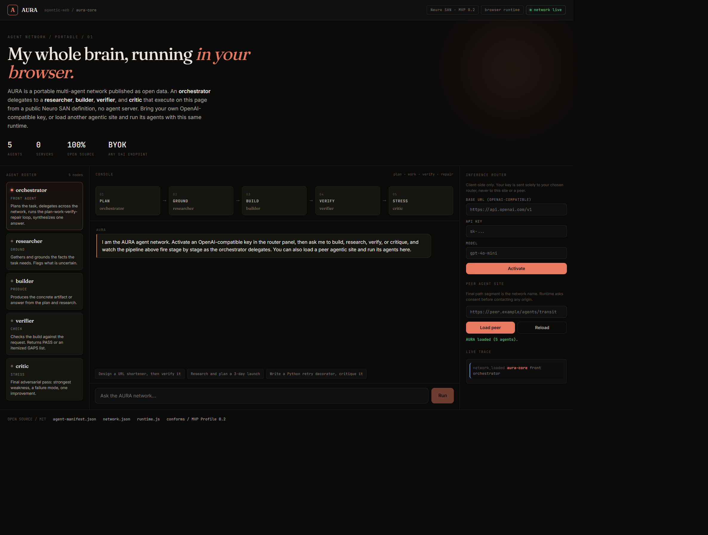

# AURA Agentic Web

**Live deployment:** [https://aura-agentic-web.vercel.app](https://aura-agentic-web.vercel.app)  
**Spec conformance:** [Worldwide Agentic Web MVP Profile 0.2](https://github.com/cognizant-ai-labs/agentic-web/blob/main/docs/worldwide_agentic_web_mvp_spec.md)  
**License:** MIT



AURA Agentic Web publishes a portable 5-agent Neuro SAN network as open static JSON data that loads and executes directly in the browser with no dedicated agent server. Visitors bring their own OpenAI-compatible inference router (BYOK) - or use an optional zero-setup server demo router when configured - to run a multi-stage **plan -> ground -> build -> verify -> stress-critique** loop in real time, inspect the live delegation trace, or load peer agentic websites into the same browser runtime.

---

## Architecture & Agent Network (`aura-core`)

Published at [`/agents/agent-manifest.json`](./public/agents/agent-manifest.json) and [`/agents/aura-core.json`](./public/agents/aura-core.json) with permissive CORS headers (`Access-Control-Allow-Origin: *`) so any conforming runtime can discover and execute the network:

1. **`orchestrator` (Front Agent - Plan & Synthesize):** Decomposes the user request, delegates self-contained tasks across specialist agents via OpenAI-compatible tool calls, drives a repair pass when verification flags gaps, and synthesizes one unified response.
2. **`researcher` (Ground):** Grounds domain facts, constraints, and edge cases, explicitly flagging uncertainty.
3. **`builder` (Produce):** Produces complete, runnable code or structured artifacts from the plan and grounded context.
4. **`verifier` (Check):** Audits the candidate build against every requirement in the prompt and returns `PASS` or an itemized `GAPS` list for repair.
5. **`critic` (Stress):** Performs a final adversarial pass identifying the strongest remaining weakness, a realistic failure mode, and one high-leverage improvement.

---

## Browser Runtime & Stateless `/api/relay` CORS Fallback

- **Pure ES Module Runtime ([`public/runtime.js`](./public/runtime.js)):**
  - Normalizes OpenAI-compatible base URLs automatically (bare origins, `/v1`, custom gateway prefixes, or full `/chat/completions` URLs).
  - Multi-provider tool-calling compatibility across OpenAI, xAI Grok, DeepSeek / Moonshot thinking models (preserving `reasoning_content` across tool-call turns and normalizing empty assistant `content` to `""`), Alibaba DashScope/Bailian, and OpenRouter.
  - Enforces execution budgets (`max_depth`, `max_agent_invocations`, `max_remote_calls`, `max_elapsed_seconds`) and per-origin user consent before loading external peer agent networks.
  - Streams structured lifecycle events (`network_loaded`, `peer_loaded`, `run_start`, `agent_start`, `agent_delegate`, `agent_done`, `run_done`, `run_error`) to the live UI pipeline and trace log.
- **Stateless Same-Origin CORS Relay ([`api/relay.js`](./api/relay.js)):**
  - The browser attempts direct `fetch()` calls to the visitor's chosen BYOK endpoint first.
  - Because many LLM gateways omit browser CORS headers (or reject browser `Origin` headers at WAF), `AuraRuntime` automatically falls back to `POST /api/relay` (`x-target-url` + `Authorization`) and caches relay preference for that endpoint for the remainder of the session to avoid repeated preflight failures.
  - `/api/relay` is 100% stateless in BYOK mode: it validates HTTPS targets, blocks private/loopback SSRF ranges, enforces a 55s upstream `AbortController` timeout (`maxDuration = 60`), stores nothing, and logs no keys or prompts.
  - **Optional Zero-Setup Demo Mode:** `GET /api/relay` reports `{ ok: true, demoAvailable, demoModel }`. When `DEMO_BASE_URL` and `DEMO_API_KEY` (plus optional `DEMO_MODEL`) are configured in Vercel environment variables, cold visitors can run the network immediately via `x-use-demo: "1"` without exposing server credentials to the client.

---

## Repository Structure

```text
.
├── api/
│   └── relay.js                  # Stateless BYOK CORS fallback & optional demo relay (maxDuration: 60s)
├── public/
│   ├── index.html                # Editorial console UI, live 5-stage pipeline, router & peer loader
│   ├── runtime.js                # Portable browser Neuro SAN runtime (ES module, MVP Profile 0.2)
│   └── agents/
│       ├── agent-manifest.json   # Site manifest advertising aura-core & BYOK policy
│       └── aura-core.json        # 5-agent Neuro SAN network definition & execution limits
├── devpost-screenshot.png        # UI preview screenshot
├── vercel.json                   # Static output, CORS headers for /agents/* & /runtime.js, function timeout
└── LICENSE                       # MIT License
```

---

## Local Development & Deployment

Serve statically or run with Vercel CLI (which also serves `/api/relay` locally):

```bash
# Run locally with Vercel dev server
npx vercel dev

# Deploy to Vercel production
npx vercel deploy --prod
```

To enable optional zero-setup demo routing on your deployment (while keeping BYOK available in the UI), set `DEMO_BASE_URL`, `DEMO_API_KEY`, and optionally `DEMO_MODEL` in your Vercel project environment variables.
